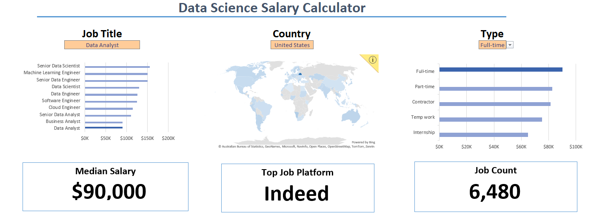
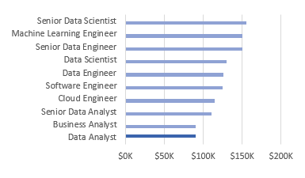
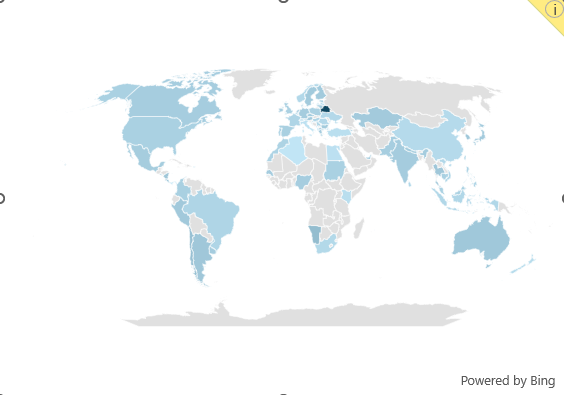
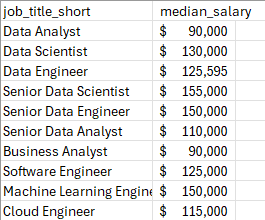
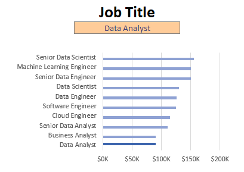
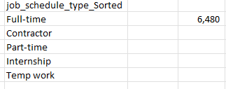
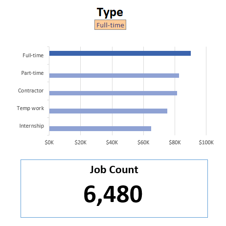
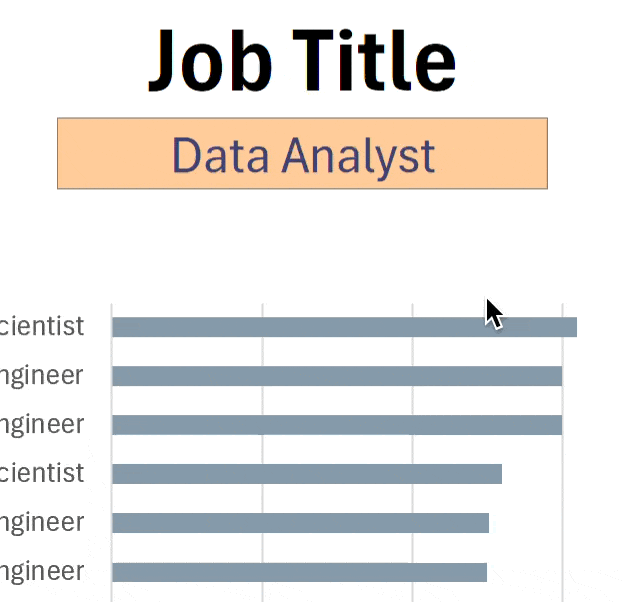

# Excel Salary Dashboard



## Introduction

This salary dashboard was created to investigate salaries for different data jobs by analyzing compensation across multiple positions and locations. The dashboard helps uncover trends and patterns that can support career research and salary comparisons.

### Dashboard File
The finished dashboard is in [Salary_Dashboard.xlsx](Salary_Dashboard.xlsx).

### Excel Skills Used

The following Excel skills were used for the analysis:

- **Charts**
- **Formulas and Functions**
- **Data Validation**

### Data Jobs Dataset

The dataset is made up of real data job postings from 2023.The data is sourced from Luke Barousse's [Excel Course](https://www.lukebarousse.com/). The data contains detailed information regarding::

- **Job titles**
- **Salaries**
- **Locations**
- **Skills**

## Dashboard Build

### Charts

#### Data Science Job Salaries - Bar Chart



- **Excel Features:** A bar chart with formatted salary values and a layout adjusted for readability.
- **Design Choice:** A horizontal bar chart makes it easy to compare median salaries side by side.
- **Data Organization:** Job titles are sorted from highest to lowest salary so the ranking is clear at a glance.
- **Insights Gained:** Senior roles and Engineer roles pay more than Analyst roles.

#### Country Median Salaries - Map Chart



- **Excel Features:** Excel's map chart feature plots median salaries around the world.
- **Design Choice:** The map is color-coded so higher and lower salary regions stand out.
- **Data Representation:** The map shows the median salary for every country that had salary data.
- **Why a Map:** It makes geographic differences in pay easier to see than a table would.
- **Insights Gained:** There is a large salary gap between countries, and the map makes the high and low regions easy to spot.

### Formulas and Functions

#### Median Salary by Job Titles

```
=MEDIAN(
IF(
    (jobs[job_title_short]=A2)*
    (jobs[job_country]=country)*
    (ISNUMBER(SEARCH(type,jobs[job_schedule_type])))*
    (jobs[salary_year_avg]<>0),
    jobs[salary_year_avg]
)
)
```

- **Multiple Filters:** The formula checks the job title, country, and schedule type, and skips rows with no salary listed.
- **Array Formula:** It uses `MEDIAN()` with a nested `IF()` statement to work through a whole range of values at once.
- **Why It's Useful:** It returns the median salary for a specific job title, country, and schedule type.
- **Formula Purpose:** This formula fills in the table below with the median salary for the job title, country, and type that are selected.

**Background Table**



**Dashboard Implementation**



#### Count of Job Schedule Type

```
=FILTER(J2#,(NOT(ISNUMBER(SEARCH("and",J2#))+ISNUMBER(SEARCH(",",J2#))))*(J2#<>0))
```

- **Unique List:** This formula uses `FILTER()` to remove entries that contain "and" or a comma, and to drop zero values.
- **Formula Purpose:** It fills in the table below with a clean list of the unique job schedule types.

**Background Table**



**Dashboard Implementation**



### Data Validation

#### Filtered List

- **Dropdown Lists:** The filtered list is applied as a data validation rule to the `Job Title`, `Country`, and `Type` options (found in the Data tab). This means:
    - Users can only choose from the predefined options
    - Typos and inconsistent entries are prevented
    - The dashboard is easier to use



## Conclusion

This dashboard shows how salaries compare across data job titles. Users can explore how location and job type affect pay, which can help when thinking about career choices.
