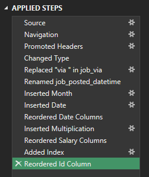
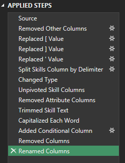
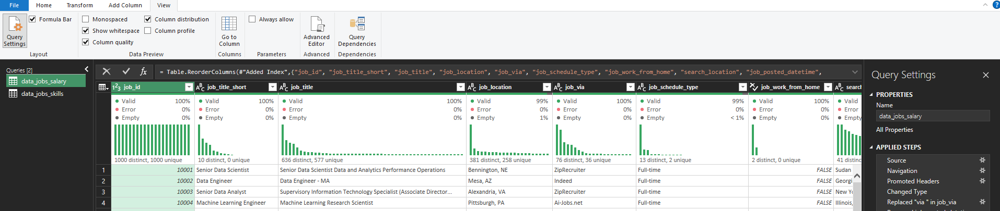
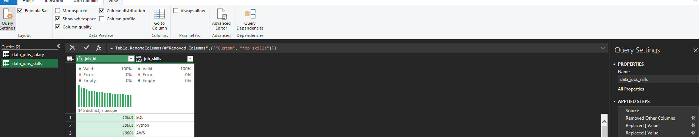
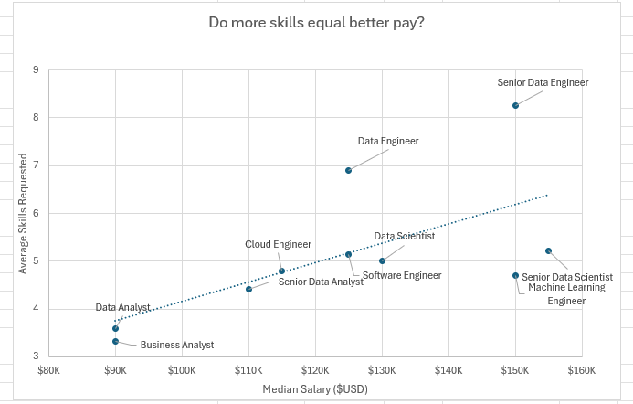
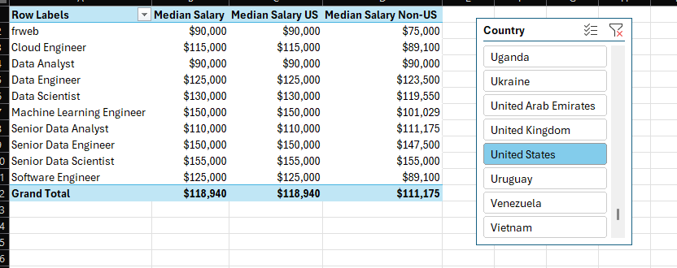
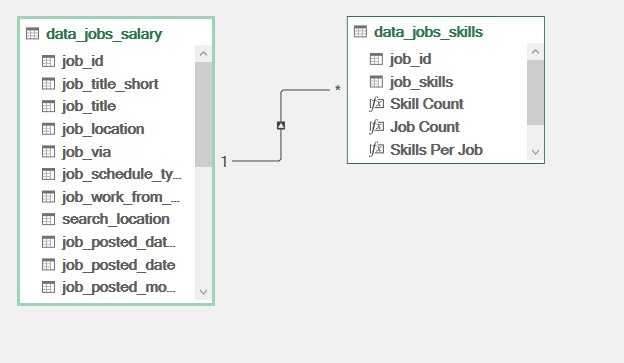
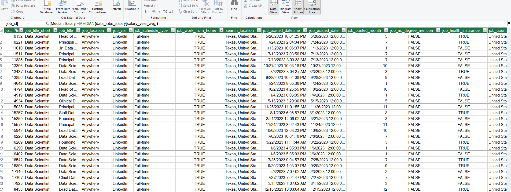
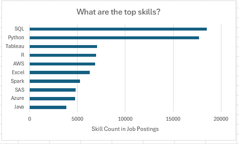
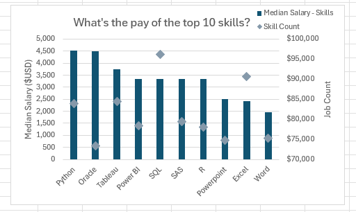

# Project 2 Analysis

## Introduction

This project looks at which skills are most frequently requested by top employers and how those skills relate to salary. The analysis shows which technical skills are in greatest demand and which may lead to higher pay in the data job market.

### Questions to Analyze

To better understand the data job market, the analysis focuses on four questions:

1. **Do more skills get you better pay?**
2. **What is the salary for data jobs in different regions?**
3. **What are the top skills of data professionals?**
4. **What is the pay for the top 10 skills?**

### Excel Skills Used

The following Excel skills were used for the analysis:

- **Pivot Tables**
- **Pivot Charts**
- **DAX (Data Analysis Expressions)**
- **Power Query**
- **Power Pivot**

### Data Jobs Dataset

The dataset contains real data job postings from 2023 and comes from Luke Barousse's [Excel Course](https://www.lukebarousse.com/).
It includes detailed information on:

- **Job titles**
- **Salaries**
- **Locations**
- **Skills**

## 1️⃣ Do more skills get you better pay?

### Skill: Power Query (ETL)

#### Extract

- Power Query was used to extract the original data (`data_salary_all.xlsx`) and create two queries:
    - The first contains all of the data job information.
    - The second lists the skills for each job ID.

#### Transform

- Each query was then transformed by changing column types, removing unnecessary columns, cleaning text to eliminate specific words, and trimming excess whitespace.
    - data_jobs_all

        

    - data_job_skills

        

#### Load

- Both transformed queries were loaded into the workbook, which set up the rest of the analysis.
    - data_jobs_all

        

    - data_job_skills

        

### Analysis

#### Insights

- There is a positive correlation between the number of skills requested in job postings and median salary, particularly for roles like Senior Data Engineer and Data Scientist.
- Roles that request fewer skills, like Business Analyst, tend to offer lower salaries. This suggests that more specialized skill sets are valued more highly in the market.

    

#### So What

- This trend highlights the value of building multiple relevant skills, especially for anyone aiming for higher-paying roles.

## 2️⃣ What is the salary for data jobs in different regions?

### Skills: PivotTables and DAX

#### Pivot Table

- A PivotTable was built from the Data Model created in Power Pivot.
- `job_title_short` was placed in the rows area and `salary_year_avg` in the values area.
- A new measure was then added to calculate the median salary for United States jobs.
    ```
    =CALCULATE(
        MEDIAN(data_jobs_all[salary_year_avg]),
        data_jobs_all[job_country] = "United States")
    ```

#### DAX

- The median yearly salary was calculated using DAX.

    ```
    Median Salary := MEDIAN(data_jobs_all[salary_year_avg])
    ```

### Analysis

#### Insights

- Roles like Senior Data Engineer and Data Scientist have higher median salaries both in the US and internationally, which points to strong global demand for experienced data professionals.
- The salary gap between US and non-US roles is especially noticeable in high-tech jobs. This may be influenced by the concentration of tech companies in the US.

    

#### So What

- These salary insights can help with planning and salary negotiations, giving professionals and companies a way to align offers with market standards while accounting for location.

## 3️⃣ What are the top skills of data professionals?

### Skill: Power Pivot

#### Power Pivot

- A data model was created by combining the `data_jobs_all` and `data_job_skills` tables.
- Because the data had already been cleaned in Power Query, Power Pivot was able to create a relationship between the two tables.

#### Data Model

- The two tables are related through the `job_id` column.

    

#### Power Pivot Menu

- The Power Pivot menu was used to refine the data model and to make creating measures easier.

    

### Analysis

#### Insights

- SQL and Python are the most requested skills in data jobs, which reflects how central they are to data processing and analysis.
- Cloud platforms like AWS and Azure also show up frequently, pointing to the industry's move toward cloud services and big data technologies.

    

#### So What

- Knowing which skills are most common helps professionals stay competitive and can guide training programs toward the most useful technologies.

## 4️⃣ What is the pay for the top 10 skills?

### Skill: Advanced Charts (Pivot Chart)

#### PivotChart

- A combo PivotChart was created to plot median salary and skill likelihood (%) from the PivotTable.
    - **Primary Axis:** Median Salary (Clustered Column)
    - **Secondary Axis:** Skill Likelihood (Line with Markers)
- To customize the chart, an axis title was added, the line for skill likelihood was removed, and the markers were changed to diamonds.

### Analysis

#### Insights

- Higher median salaries are associated with skills like Python, Oracle, and SQL, which suggests they play a key role in high-paying tech jobs.
- Skills like PowerPoint and Word have the lowest median salaries and are requested less often, which suggests less specialization and lower demand in high-paying roles.

    

### So What

- This chart shows the value of learning high-impact skills like Python and SQL, which are tied to higher-paying roles, especially for anyone looking to maximize their salary in tech.

## Conclusion

This project uses Excel to analyze real-world data job postings and uncover insights into the data job market. By cleaning, organizing, and visualizing the data with Power Query, PivotTables, and interactive dashboards, I explored salary trends, hiring patterns, and the skills most commonly requested by employers. The analysis provides a clear view of how different roles, locations, and technical skills influence compensation.
